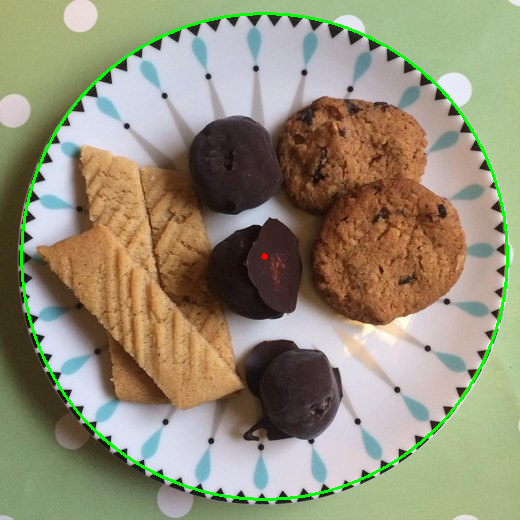
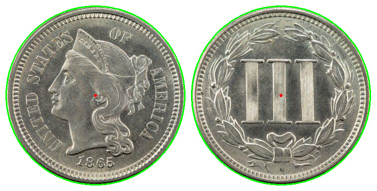

# 霍夫圆检测工具

基于 OpenCV `HoughCircles` 的单图交互式调参 GUI（PyQt5）：导入图片、调节参数、预览检测结果、导出标注图。发行名 `hough-circle-gui`，导入名 `hough_gui`。

## 现状

图片模式已实现：导入图片、六参数调参、参数变化自动重检、叠加预览、状态栏数量与耗时、导出原分辨率标注图。`add-hough-circle-gui` 与 `add-real-image-acceptance` 两个 change 已归档，基线规格位于 `openspec/specs/{image-io,circle-detection,detection-workbench}/spec.md`。真实图片的验收参数、结果与证据图见「[验收参数与结果](#验收参数与结果)」。

视频模式（导入视频并逐帧检测）已完成规划但未实现，规划与交接记录见 `openspec/changes/add-video-detection-input/`；当前完成度、未验证事项和后续待办见该目录的 `handover.md`。

## 环境要求

- Ubuntu 24.04 + ROS 2 Jazzy（本仓库已验证的环境）
- Python ≥ 3.10
- 系统包：`sudo apt install python3-opencv python3-pyqt5 python3-venv python3-pytest`
- WSL2 下需要 WSLg：`echo $DISPLAY` 应输出非空值（如 `:0`）

## 安装

```bash
python3 -m venv --system-site-packages .venv
. .venv/bin/activate
pip install -e . --no-deps
```

`--system-site-packages` 让虚拟环境复用系统已装的 `cv2` 与 `PyQt5`（与 ROS 2 rqt 同源）；`--no-deps` 阻止 pip 用 PyPI wheel 覆盖这些 apt 包。`pyproject.toml` 中声明的依赖是运行时契约，供非 ROS 环境或 CI 参考。

## 启动方式

安装完成后，任选一种：

```bash
.venv/bin/python -m hough_gui   # 不激活 venv
```

```bash
. .venv/bin/activate
python3 -m hough_gui            # 或执行 hough-gui
```

## 使用流程

1. 「打开图片」选择 PNG / JPEG / BMP / TIFF 文件；加载成功后立即按当前参数检测一次。
2. 在左侧调整 `dp`、`minDist`、`param1`、`param2`、`minRadius`、`maxRadius`；数值变化约 150 ms 后自动重检并刷新预览。
3. 「导出标注图」保存为 PNG，像素尺寸与原图一致。

## 参数说明

| 参数 | 含义 | 范围 | 默认 |
|---|---|---|---|
| `dp` | 累加器分辨率与图像分辨率之比 | 1.0–3.0 | 1.0 |
| `minDist` | 圆心最小间距（像素） | 1–2000 | 50 |
| `param1` | Canny 高阈值（低阈值取其一半） | 1–500 | 100 |
| `param2` | 圆心累加器阈值，越小检出越多 | 1–200 | 30 |
| `minRadius` | 最小半径（像素） | 0–2000 | 0 |
| `maxRadius` | 最大半径（像素），**0 表示无上限** | 0–2000 | 0 |

调参直觉：`param2` 过小会误检、过大则漏检；`minDist` 小于目标圆间距时同一个圆会被重复检出。默认 `param2=30` 面向边缘平滑的真实图像；边缘是硬阶跃的合成图通常需要更低的 `param2`（约 15）才会检出。

检出圆在 Hough 结果基础上还会做一次边缘微调：在圆心 ±5 像素、半径 0.85–1.25 倍范围内搜索圆周梯度最强的同心圆（受 `minRadius`/`maxRadius` 约束），因此半径会贴合真实外沿而不是内圈纹理。带齿纹或多层同心边的目标需要提高 `param2` 并用 `minRadius` 收紧半径搜索；硬币与盘子的实测参数见下节。

## 验收参数与结果

两张原始样图只保留在本地 `samples/`（不入库）；按下列参数在 GUI 中打开对应图片，应得到表中的结果。标注结果图保存在 `docs/acceptance/`，随仓库提交。

| 参数 | 盘子 `samples/plate.png`（520×520） | 硬币 `samples/coins.jpg`（760×385） |
|---|---:|---:|
| `dp` | 1.0 | 1.0 |
| `minDist` | 250 | 250 |
| `param1` | 100 | 100 |
| `param2` | **60** | **150** |
| `minRadius` | **200** | **120** |
| `maxRadius` | 0（无上限） | 0（无上限） |

| 验收项 | 盘子 | 硬币 |
|---|---|---|
| 检出数量 | 1 | 2 |
| 圆心（px） | (263.5, 256.5) | (192.5, 191.5)、(566.5, 191.5) |
| 半径（px） | 243.3 | 180.0、179.5 |
| 贴合位置 | 盘子最外沿 | 两枚硬币的外齿圈 |

**盘子**：`minRadius=200` 把搜索限定在盘子外沿量级的半径，`param2=60` 已足够检出外沿并排除内部纹样与背景高对比边缘。



**硬币**：`param2=150` 抑制硬币内部人像与花环纹理，`minRadius=120` 保留半径约 180 px 的外圈，`minDist=250` 小于两枚硬币圆心间距（约 374 px），既不会合并两枚硬币，也能排除同一硬币内部的重复圆。



验收环境、复核命令与完整记录见 `openspec/changes/archive/2026-11-15-add-real-image-acceptance/acceptance.md`。

## 样例获取

`samples/` 被 `.gitignore` 排除，不随仓库分发。两类样例的处理方式不同：

- **自动化测试**：不依赖 `samples/`。测试用 `cv2` 现场合成黑底白圆图像，按 README 的测试命令即可复现。
- **真实图片验收**：需要自行取得下列原图，按表中尺寸缩放/裁剪后放到 `samples/`。许可与署名如下。

| 本地文件 | 来源与许可 | 处理 |
|---|---|---|
| `samples/coins.jpg` | Jaclyn Nash / Smithsonian Institution, National Numismatic Collection, [1865 Three-Cent Nickel](https://commons.wikimedia.org/wiki/File:NNC-US-1865-3C-Three-Cent,_Nickel.jpg)，Wikimedia Commons 标注为美国公有领域 | 两枚硬币并排，缩放到 760×385 |
| `samples/plate.png` | Helen Alfvegren，[Plate of Three Types of Cookies](https://commons.wikimedia.org/wiki/File:Plate_of_Three_Types_of_Cookies.jpg)，[CC BY 2.0](https://creativecommons.org/licenses/by/2.0/) | 缩放到 520×520 |

如果使用不同裁剪或缩放版本，圆心与半径可能相差几个像素；验收数值以 README 上表和 `docs/acceptance/` 的证据图为参考。视频模式尚未实现，样例视频的获取方式会在实现时补充到本节。

## 功能与非功能约束

- 导入图片：PNG / JPEG / BMP / TIFF，中文路径可用
- 调参预览：参数变化后重跑检测，在原图上叠加绿色轮廓与红色圆心
- 结果统计：状态栏显示 `圆: <数量> | 耗时: <毫秒> ms`
- 导出标注图：原分辨率 PNG；写入失败不破坏既有同名文件

约束：

- 文件读写支持中文路径：`np.fromfile` + `cv2.imdecode` / `cv2.imencode` + `tofile`，不用 `cv2.imread` / `cv2.imwrite`
- 图像一律渲染在 Qt 控件中，不使用 `cv2.imshow`
- 检测逻辑与 Qt 解耦（`hough_gui/core/`），可无界面单测
- 检测在后台线程执行；同一时刻只有一个检测线程，改动期间的新请求在其结束后按最新参数补跑

## 目录结构

```text
camera_test/
├── .agents/skills/                     # openspec init 生成的技能
├── .gitignore
├── README.md
├── pyproject.toml                      # 打包、依赖、pytest 配置、hough-gui 入口
├── docs/
│   └── acceptance/                     # 验收证据图（入库）
│       ├── plate_result.png
│       └── coins_result.png
├── samples/                            # 本地验收原图（不入库）
│   ├── plate.png
│   └── coins.jpg
├── openspec/
│   ├── config.yaml                     # schema + 项目上下文（Agent 每次读取的约束）
│   ├── specs/                          # 基线规格：image-io / circle-detection / detection-workbench
│   └── changes/
│       ├── add-video-detection-input/  # 视频导入逐帧检测：规划、任务与交接记录
│       └── archive/
│           ├── 2026-11-15-add-hough-circle-gui/       # 首个 change：GUI 实现
│           └── 2026-11-15-add-real-image-acceptance/  # 真实图片验收与证据
├── src/hough_gui/
│   ├── __init__.py
│   ├── __main__.py                     # python3 -m hough_gui
│   ├── core/
│   │   ├── params.py                   # HoughParams + 参数校验
│   │   ├── detector.py                 # detect_circles，无 Qt 依赖
│   │   └── imageio.py                  # 中文路径读写、叠加渲染、原子导出
│   └── ui/
│       └── main_window.py              # MainWindow 与 DetectThread
└── tests/
    ├── test_params.py
    ├── test_detector.py
    └── test_imageio.py
```

## 开发流程（OpenSpec）

`openspec/specs/` 是归档产物，**不手工编辑**；所有功能变更都走 change 提案。

1. `/openspec-propose "<想法>"` —— 一次生成 `proposal.md`、`specs/<capability>/spec.md`（delta）、`design.md`、`tasks.md`
2. `/openspec-apply-change` —— 按 `tasks.md` 实施并逐条勾选
3. `/openspec-archive-change` —— 归档变更，把 delta 合入基线规格

其他技能：`/openspec-explore`（先想清楚）、`/openspec-update-change`（修订提案）、`/openspec-sync-specs`（不归档只同步规格）。core profile 只生成上述 6 个；`new`、`continue`、`ff`、`bulk-archive`、`verify`、`onboard` 用 `openspec config profile` 追加。

常用 CLI：

| 命令 | 用途 |
|---|---|
| `openspec list` | 列出未归档变更 |
| `openspec list --specs` | 列出基线能力 |
| `openspec show <change>` | 查看变更详情 |
| `openspec validate --strict` | 校验变更与规格格式 |
| `openspec archive <change>` | 归档变更（CLI 等价于技能） |
| `openspec context` | 打印 Agent 看到的项目上下文 |

## 测试

```bash
.venv/bin/python -m pytest
```

pytest 来自 apt 包，venv 只暴露其模块、没有 `.venv/bin/pytest`，因此用 `python -m pytest`。用例图像由 cv2 合成（`lineType=cv2.LINE_AA`），不提交二进制图片；`docs/acceptance/` 下的验收证据图是唯一例外。

## Git 约定

提交信息 `<type>: <short description>`，`type` ∈ `feat | fix | refactor | docs | chore | test | build`，描述用简短英文，例如 `feat: add hough circle detector core`。当前为单分支 `main`、单开发者直接提交。

## 纳入 / 不纳入版本库

纳入：

- `pyproject.toml`、`README.md`、`.gitignore`
- `openspec/**`（`config.yaml`、`specs/`、`changes/`）
- `.agents/skills/**`（OpenSpec 生成的技能，保证 Agent 行为可复现）
- `src/**`、`tests/**`
- `docs/acceptance/*.png`（验收证据图，供 README 直接引用）

不纳入：

- `.venv/`（本机虚拟环境）
- `__pycache__/`、`*.egg-info/`、`.pytest_cache/`、`build/`、`dist/`（构建与缓存产物）
- `samples/`、`out/`、`*.log`（本地测试图与导出结果）
- `.vscode/`、`.idea/`、`.DS_Store`（编辑器）

理由：可复现的配置、规格与验收证据入库；环境、缓存、原始测试图与临时导出不入库。

## 常见问题

- **Qt 起不来 / `xcb` 插件加载失败**：WSL2 需 WSLg，确认 `echo $DISPLAY` 非空，必要时执行 `wsl --update`。
- **界面中文显示为方框（乱码）**：系统缺少中文字体，WSL2 上新装的发行版常见。启动时若检测不到简体中文字体，程序会按 `msyh.ttc` → `NotoSansSC-VF.ttf` → `simsun.ttc` → `Deng.ttf` 的顺序从 `/mnt/c/Windows/Fonts/` 加载宿主 Windows 字体并设为应用字体；如宿主字体也不可用，执行 `sudo apt install fonts-noto-cjk`。
- **窗口标题是英文**：WSLg 的标题栏由 Weston 绘制，不经过 Qt 字体回退，装中文字体也无法显示中文，因此标题固定为 `Hough Circle Detection`，界面内文字仍为中文。
- **中文路径读不出图**：`cv2.imread` / `cv2.imwrite` 对非 ASCII 路径不可靠，统一走 `np.fromfile` + `cv2.imdecode` 与 `cv2.imencode` + `tofile`。
- **venv 里装了 PyQt5 wheel，与 rqt 冲突**：`pip uninstall PyQt5`，用 `--system-site-packages` 重建 venv，复用系统包。
- **参数面板出现红字**：参数组合非法（如 `minRadius` 大于非零的 `maxRadius`），此时不会发起检测，预览保留上次结果。
